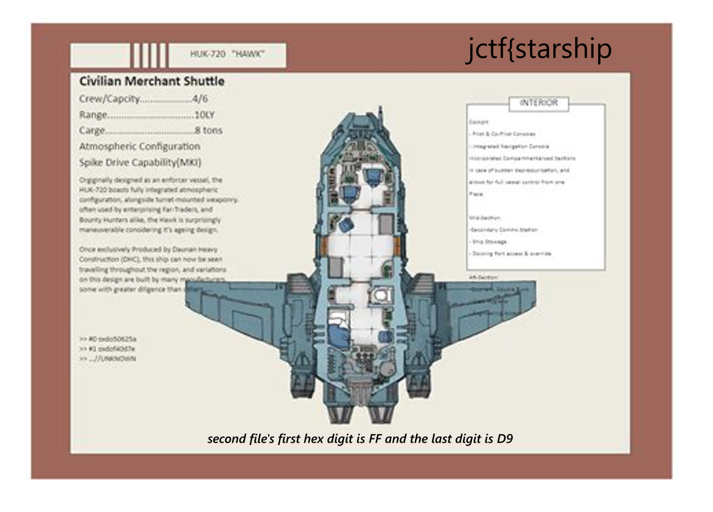
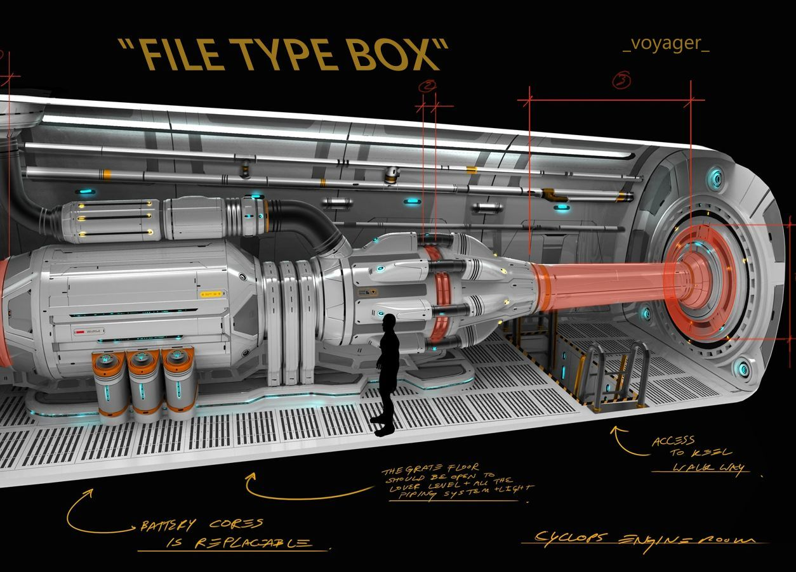

# Fix Your Ship

**JerseyCTF VI · 2026**

Three damaged files, three linked clues, and a flag assembled from the repaired evidence. This was a small file-repair challenge where careful inspection beat guesswork.

[View the styled writeup on my website](https://codewithdaniel1.github.io/writeups/2026/jerseyCTF-vi/fix-your-ship/fix-your-ship.html)

## The challenge

Our spaceship has crash-landed, and we need to repair its engine. Unfortunately, the files containing the ship's schematics have been corrupted.

It supplies three files with altered hexadecimal bytes. The first is meant to be a PNG, and its contents provide clues for repairing the other two.

- [Original challenge file · file1](assets/original/file1)

- [Original challenge file · file2](assets/original/file2)

- [Original challenge file · file3](assets/original/file3)

## First look at the files

A quick hex view exposes recognizable format markers. The file sizes also help confirm which byte positions are being discussed.

```
xxd -l 24 file1
xxd -l 24 file2
xxd -l 24 file3
xxd -s -16 file2
```

<table class="writeup-table">
            <thead><tr><th>Artifact</th><th>Evidence</th><th>Likely format</th></tr></thead>
            <tbody>
              <tr><td><code>file1</code></td><td><code>89 00 00 00 0d 0a 1a 0a</code></td><td>PNG signature with three damaged bytes</td></tr>
              <tr><td><code>file2</code></td><td><code>JFIF</code> appears in its header; final two bytes are zero</td><td>JPEG</td></tr>
              <tr><td><code>file3</code></td><td>ISO Base Media box header contains <code>pfyt</code></td><td>MP4 with a damaged <code>ftyp</code> box type</td></tr>
            </tbody>
          </table>
        

The challenge gives the PNG format directly. The JPEG clue becomes clear from the embedded `JFIF` identifier, and the phrase “FILE TYPE BOX” in that recovered image points to the MP4 container structure.

## 1. Restore the PNG

A PNG must begin with the eight-byte signature `89 50 4e 47 0d 0a 1a 0a`. The supplied file has the correct first byte and trailing four bytes, but the three ASCII bytes for `PNG` have been zeroed at offsets `0x01–0x03`.

```
cp file1 file1.png
printf 'PNG' | dd of=file1.png bs=1 seek=1 conv=notrunc status=none
file file1.png
```

After replacing just those three bytes, the image opens. Its ship schematic contains the first flag segment and a clue for repairing the next file.



*Recovered `file1.png`. The note “first hex digit” refers to the first byte: the JPEG begins with `ff` and ends with `d9`.*

**Recovered:** `jctf{starship`

**Next clue:** the second file starts with byte `ff` and ends with byte `d9`.

## 2. Restore the JPEG

The string `JFIF` at offset `0x06` identifies the image as a JPEG. A common JFIF header begins `ff d8 ff e0`. In this file, the first three bytes are zero, while the existing `e0` and JFIF header remain intact.

The clue from the PNG gives the required ending. JPEG files end with the End of Image marker `ff d9`; the supplied file instead ends in two zero bytes.

```
cp file2 file2.jpg
printf '\377\330\377' | dd of=file2.jpg bs=1 seek=0 conv=notrunc status=none
printf '\377\331' | dd of=file2.jpg bs=1 \
  seek=$(($(wc -c < file2.jpg)-2)) conv=notrunc status=none
file file2.jpg
```

The repaired JPEG reveals another schematic. The text `_voyager_` supplies the next flag segment. The heading “FILE TYPE BOX” is also the hint needed for the last file.



*Recovered `file2.jpg`. “FILE TYPE BOX” points to the MP4 `ftyp` box; the marked engine walkthrough is part of the challenge’s visual clue.*

**Recovered:** `_voyager_`

**Next clue:** inspect the MP4 File Type Box, whose box type should be `ftyp`.

## 3. Restore the MP4

ISO Base Media files are organized into boxes. The first four bytes here, `00 00 00 20`, declare a 32-byte box. The following four bytes are its type. They currently spell `pfyt`, but the image clue tells us to look for the File Type Box: `ftyp`.

Replacing the four-byte type at offset `0x04` restores the box. The file’s remaining content is intact.

```
cp file3 file3.mp4
printf 'ftyp' | dd of=file3.mp4 bs=1 seek=4 conv=notrunc status=none
file file3.mp4
ffprobe -v error -show_entries format=duration,format_name \
  -of default=noprint_wrappers=1 file3.mp4
```

The repaired video is about 4.2 seconds long. A frame from around one second in shows the final flag fragment, `apollo}`.

[Watch the recovered video](assets/recovered/fix-your-ship-recovered.mp4)

Recovered challenge video, playable in the page or available to download.

**Recovered:** `apollo}`

## Flag and byte changes

Reading the visible fragments in order and joining them without adding or removing characters gives the flag:

```
jctf{starship_voyager_apollo}
```

<table class="writeup-table">
            <thead><tr><th>File</th><th>Offset(s)</th><th>Before</th><th>After</th><th>Reason</th></tr></thead>
            <tbody>
              <tr><td><code>file1</code></td><td><code>0x01–0x03</code></td><td><code>00 00 00</code></td><td><code>50 4e 47</code></td><td>Restore PNG signature</td></tr>
              <tr><td><code>file2</code></td><td><code>0x00–0x02</code></td><td><code>00 00 00</code></td><td><code>ff d8 ff</code></td><td>Restore JPEG start marker</td></tr>
              <tr><td><code>file2</code></td><td><code>0x02d413–0x02d414</code></td><td><code>00 00</code></td><td><code>ff d9</code></td><td>Restore JPEG end marker</td></tr>
              <tr><td><code>file3</code></td><td><code>0x04–0x07</code></td><td><code>70 66 79 74</code></td><td><code>66 74 79 70</code></td><td>Change box type from <code>pfyt</code> to <code>ftyp</code></td></tr>
            </tbody>
          </table>
        

That is 11 changed byte positions across all three files: three in the PNG, five in the JPEG, and three in the MP4. The third character in `pfyt` was already `y`, so the MP4 replacement changes three positions of the four-byte field.

## Reproduce the repairs

The included Python script checks that each expected damaged byte sequence is present before writing a repaired copy. It leaves the original files untouched and uses only Python’s standard library.

```
python3 solve_fix_your_ship.py assets/original/file1 assets/original/file2 assets/original/file3 --out repaired
```

- [Download Python repair script](solve_fix_your_ship.py)

- [Recovered PNG](assets/recovered/fix-your-ship-schematic.png)

- [Recovered JPEG](assets/recovered/fix-your-ship-engine.jpg)

- [Recovered MP4](assets/recovered/fix-your-ship-recovered.mp4)

**Verification note:** the flag is reconstructed from the supplied challenge artifacts and the repaired media was inspected locally. I have not independently confirmed an online scoreboard submission.

The useful lesson is simple: corruption does not always mean the whole file is lost. A few format-specific bytes can be enough to make the original content readable again. Start with what the file says about itself, follow evidence between artifacts, and keep repairs as small and verifiable as possible.
